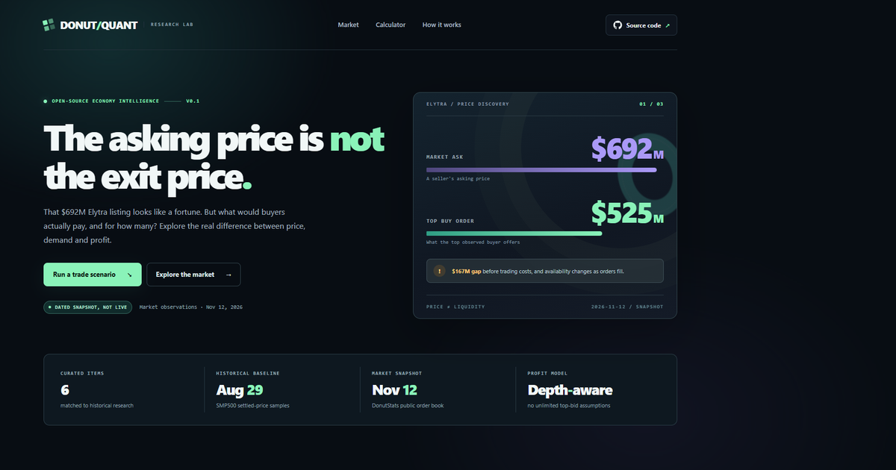

# donut-quant

**Try the free market-exit laboratory:** https://aeripsen.github.io/donut-quant/



[](https://github.com/Aeripsen/donut-quant/actions/workflows/verify.yml)

Instead of assuming you can sell every item at today's highest bid, the
[Market Terminal](docs/MARKET_TERMINAL.md) simulates **finite order-book depth**,
unsold inventory, optional Sell Axe fallback, fees, and your actual cost basis.
Paste your own current bids; no sign-in required. The six included price
examples are dated Nov 11-12, 2026, **not live quotes**.

The original research and 2026-08/09 snapshots remain below, but should not
be used as current trading recommendations. Data from
[DonutStats.io](https://donutstats.io); see [data notice](DATA_NOTICE.md).


## November 12, 2026: evidence-first economic model

This project now distinguishes **observed transaction events**, **standing orders**,
**asking prices**, **current inventory**, and **modeled profit** as different things.
The old August/September economic analysis remains an historical baseline; its
snapshots and original method rankings must **not** be presented as live November prices.

Start with:
- [System entities, state transitions, conservation laws and observability](docs/SYSTEM_MODEL.md)
- [Dated August-to-November market comparison and depth-aware Sell Axe math](docs/MARKET_AUDIT_2026-11-12.md)
- [Safe inventory, account access and API snapshot instructions](docs/ACCESS_CAPTURE.md)

### Rebuild local private evidence (on your own authorized computer)

```powershell
cd "$HOME\donut-quant"
python quant/personal_ledger.py
python quant/linked_db.py
python -m unittest discover -s tests -v
```

This scans the two local Modrinth profiles read-only and creates
`private/ledger/personal_events.csv`, `private/ledger/summary.json`,
and `private/economy.sqlite`. Private data is excluded from Git. Missing
acquisition costs and order escrow mean **true realized net profit remains unknown**,
even if partial sale receipts have been reconstructed.

### Optional live/historical API evidence (account owner provides read-only key locally)

```powershell
$env:DONUTSTATS_API_KEY = Read-Host 'DonutStats read-only key'
python quant/donutstats_snapshot.py --player YOUR_IGN --item elytra --item dried_kelp_block --include-global --max-requests 12
python quant/import_market.py
Remove-Item Env:DONUTSTATS_API_KEY
```

The separate DonutStats API key is **not** the official DonutSMP `/api` key. The
snapshotter stores JSON in `private/market` and respects a persistent
20-request-per-hour local free-tier budget. It collects only the requested first
history page; a deep historical backfill needs cursor pagination and its own
rate budgeting. Both API responses and current game screens must be checked for
timestamps. `quant/import_market.py` imports observed order fills, order
snapshots, quote observations and listing lifecycles by exact variant into SQLite,
without falsely treating closed listings as completed sales.

`quant/sell_routing.py` is a **conditional** order-depth simulation, not a
claim that the server necessarily uses those settings today. Its bid matching is
exact-variant, and tax and the effective `/worth` value must be verified in game.

---

I wanted to know where the money actually is on DonutSMP instead of trusting "5 billion a day" thumbnails,
so I pulled the numbers and ran the math over every recipe in the game. This repo is the data, the scripts and the write-up.

Short version: the auction house pays per stack, not per item. A stack of almost any basic block clears for 5-20K,
while `/orders` fill at a fraction of that (spruce logs 72 on orders vs ~330 per log in stack sales, bones 137 vs ~700,
obsidian 601 vs ~1,100, TNT 1,700 vs ~3,900). So for a normal player with 18 slots the game is "how much value can I
put in one slot and how fast does it turn", not "how many blocks per hour does my farm make". Farm-to-`/sell` only pays
at mega scale with a sell axe, and the famous slab farm nets about $22 per log at its own numbers.

The full write-up with 40 methods, each re-priced on live data and scored, is in [`report/analysis.md`](report/analysis.md).
`report/desk.html` is the same thing as a single page with charts.

## What is in here

- `quant/donut.py` is THE machine: every buy/transform/sell path, all three channels, ranked by the constraint that actually binds (capital, furnace throughput, or market depth).
- `quant/player.py` profiles any player from public stats: how much of a balance /sell explains, versus AH/orders/transfers.
- `quant/build_prices.py` merges every price source into `quant/price_table.csv`, one row per item:
  SMP500 settled sales (24h aggregates plus the median of the last 15 full-stack sales), LootSeller top order bid and floor,
  the last recorded sale, a June order-book snapshot, my own AH log prices.
- `quant/arbitrage.py` prices every Minecraft 1.21.11 recipe with the cheapest input source and ranks the crafts.
- `quant/orders_to_ah.py` and `quant/report_tables.py` build the order-bid vs auction-sale spread tables with a slot-hour model.
- `quant/conversion.py` answers "which form of this raw input is worth most per unit" (log -> planks -> slabs -> fences...).
- `quant/quant_summary.py` renders the compact market read (`quant/quant_summary.md`).
- `quant/potions.py` prices brewing per AH slot (potions do not stack, so one potion is one slot).
- `quant/bottleneck.py` walks the recipe graph backwards to find the scarce ingredient a valuable thing needs.
- `quant/hoard.py` classifies supply (renewable / structure loot / dead source) and where each price sits in its own range.
- `quant/accumulation.py` catches rising order bids before the auction floor reprices (the bid moves first, every time).
- `quant/transform.py` prices the edges recipes.json cannot see: every villager trade and furnace smelt.
- `quant/frontier.py` prices the mechanisms no recipe file contains: axe-stripping, stonecutter cuts, concrete mixing, shulker dyeing, oxidation, ranches.
- `quant/goldrush.py` prices the young markets: new-content recipes (bundles, harnesses, maces), the disc-farm drop table EV, retail-split leads.
- `quant/farms.py` ranks 101 buildable production systems (spawner, mob, breeding, plant, tree, villager, raid, storm, processing) by absorption-capped profit per day.
- `quant/whale.py` sizes the capital plays: accumulation trades, market making, thin-book takeovers, buy-order outsourcing.
- `quant/sellchannel.py` compares the uncapped /sell channel against the auction house, and prints the /worth break-even for every bulk block.
- `quant/autocraft.py` prices the autocrafter lanes: /orders buys the input, crafters do the work, a deep output book absorbs it.
- `quant/worthengine.py` reads the server's own /worth table (screenshotted in game) and answers craft-or-not, /sell-or-AH, and what is safe to feed a sell axe.
- `quant/engine.py` is the decision machine: every flip, craft, brew and hold on one $/slot-hour scale, allocated against real market depth.
- `quant/fetch_official.py` talks to the official API (`/api` in game gives you a key) and keeps a local sqlite of sales.
- `api/` raw snapshots pulled 2026-08-29. `mcdata/` is PrismarineJS minecraft-data for 1.21.11; SMP500 item ids equal these ids.
- `sources/` wiki text, method cards mined from videos and blogs, and the list of videos I read.
- `ah_events_anon.csv` my own auction-house events from three days of chat logs, other players pseudonymised.

## Reading the numbers

- Trust `tx_stack_med` (median of the last 15 full-stack sales). The 24h average is polluted by disguised payments
  (people "buy" a stick for 30K to move money) and renamed items.
- Tools, armor and books are excluded from craft math: their AH price is the enchanted copy, not the plain item.
- Order bids marked `(jun)` are from a June snapshot and are stale; read the live bid off `/orders` before acting.
- In the August/September baseline the AH tax was unknown and all modeled spreads are pre-tax. On November 12, 2026 client logs display a +2% listing tax quote; the accounting settlement method still needs verification. Older scripts default TAX to 0 and their projections must not be reused unadjusted.

## Running it

```
python quant/build_prices.py
python quant/report_tables.py
python quant/conversion.py
python quant/quant_summary.py
```

SMP500 sits behind Cloudflare, so the snapshot was pulled through a logged-in browser tab (`/item/{id}/__data.json`).
LootSeller is a free endpoint: `python ls_sweep.py` refreshes it in about 12 minutes.

Not affiliated with DonutSMP. Numbers are in-game dollars.
